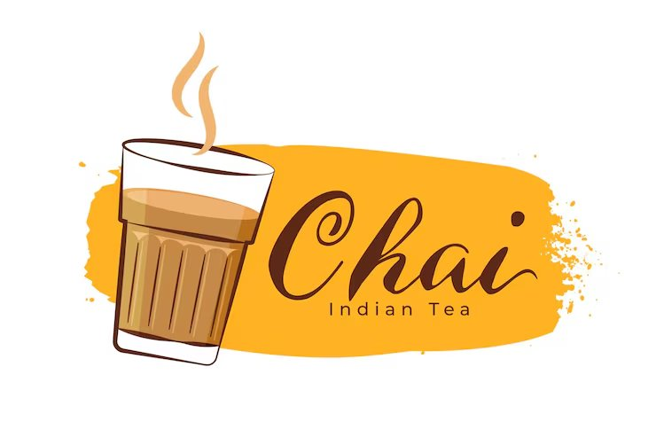

# DevDrop

<p align="center">
  
</p>

<p align="center">
  <strong>Your devices. Your network. Your files.</strong>
</p>

<p align="center">
  <a href="#quick-start">Quick Start</a> •
  <a href="#ecosystem">Ecosystem</a> •
  <a href="#features">Key Features</a> •
  <a href="#architecture">Architecture</a> •
  <a href="#documentation">Documentation</a> •
  <a href="#deployment-vercel">Vercel Deployment</a>
</p>

---

DevDrop is an open-source, zero-cloud local network file transfer and clipboard sharing system for Windows PCs, Android phones, and tablets. Files and text snippets move directly over your local Wi-Fi at gigabyte-scale speeds — completely private, without internet upload caps, and without third-party servers.

## Ecosystem Overview

```
                                  ┌────────────────────────┐
                                  │   Chrome Extension     │
                                  │   (Auto-starts server  │
                                  │    on-demand via       │
                                  │    Native Messaging)   │
                                  └───────────┬────────────┘
                                              │ stdio
                                  ┌───────────▼────────────┐
                                  │     DevDrop Server     │
                                  │   (Node.js + Express)  │
                                  │   SQLite DB • port 4545│
                                  └───────┬────────┬───────┘
                     HTTP / Socket.IO     │        │  Static Files
            ┌─────────────────────────────┘        └──────────────────────────┐
            │                                                                 │
┌───────────▼────────────┐                                        ┌───────────▼────────────┐
│      Host Web App      │                                        │   Native Android App   │
│  (React 18 + Tailwind) │◄══════════════════════════════════════►│   (Expo SDK 58 Stable) │
│   • Drag & Drop Send   │         Local Wi-Fi Network            │   • Multi-File Batch   │
│   • Quick Text Drop    │        (Zero Cloud, Max Speed)         │   • Camera QR Pairing  │
│   • Dynamic Directory  │                                        │   • Phone-to-Phone QR  │
│   • Direct Clipboard   │                                        │   • Clipboard & Share  │
└────────────────────────┘                                        └────────────────────────┘
```

## Key Features

- ⚡ **Local Wi-Fi Speeds:** Streams binary chunks directly over LAN. Zero base64 overhead, zero JavaScript memory buffering.
- 📱 **Native Android Client:** Built on Expo SDK 58 and React Native 0.88 with Camera QR scanning, Android 13+ granular media permissions, multi-file batch picker, and phone-to-phone direct sharing.
- 📋 **Cross-Device Quick Text & Clipboard Drop:** Instantly push URLs, OTPs, notes, or code between your PC and phone. Copied images write directly to your OS clipboard as PNG for instant `Ctrl + V` pasting.
- 🧩 **On-Demand Browser Extension:** Manifest V3 extension featuring Chrome Native Messaging. Opening the extension spins up the server on demand; clicking **Stop Server** terminates it and frees 100% of CPU and RAM.
- 📂 **Dynamic Storage Management:** Customize the PC storage location (`From-Mobile`, `From-PC`, `Temporary`) directly from the Web settings UI on the fly.
- 🛡️ **Cryptographic Pairing & Security:** One-time QR tokens, SHA-256 token hashing, strict path traversal guards, and zero telemetry.

---

## Quick Start

### 1. Start Server on PC
You can start DevDrop with a single double-click on Windows:
- Double-click **`DevDrop.bat`** (starts server and opens `http://localhost:4545`).
- Double-click **`Stop-DevDrop.bat`** to stop and release all system resources.

Or via terminal:
```bash
# Start server
npm run devdrop:start

# Stop server & free memory
npm run devdrop:stop
```

### 2. Download the Android App
The compiled release APK is ready to install:
- **Direct file:** [dist/devdrop.apk](dist/devdrop.apk)
- **Over-the-Air LAN download:** While connected to your Wi-Fi, open `http://<YOUR_PC_IP>:4545/devdrop.apk` on your phone browser.

### 3. Load the Browser Extension
1. Open Chrome/Edge and go to `chrome://extensions`.
2. Enable **Developer mode** in the top right.
3. Click **Load unpacked** and select `apps/extension/dist`.

---

## Direct Text & Clipboard Sharing

1. Navigate to the **Quick Text** tab on your PC Dashboard (`/text`) or tap **💬 Quick Text** on the Android app.
2. Type or paste your text/link/code and choose the target device.
3. Click **Send Text**.
4. The receiving device instantly gets a live notification with a 1-tap **Copy to Clipboard** button.

---

## Deployment (Vercel)

The web dashboard includes a full showcase Product Landing Page (`/`) and SPA configuration compatible with Vercel.

To deploy the showcase landing page to Vercel:
```bash
npm install -g vercel
vercel
```
`vercel.json` is preconfigured with Vite build commands and single-page-app route rewrites.

---

## Documentation & Transparency

| Document | Description |
|---|---|
| [SECURITY.md](SECURITY.md) | Safe software declaration, permissions transparency & audit guide |
| [docs/ARCHITECTURE.md](docs/ARCHITECTURE.md) | Complete system architecture, state machines, component specs |
| [docs/API.md](docs/API.md) | Full REST API reference & Socket.IO event catalogue |
| [docs/DEVELOPMENT.md](docs/DEVELOPMENT.md) | Local developer environment setup, build instructions |

---

## Author & Maintainer

Created and actively maintained by **Debanjan** ([@Debanjan110d](https://github.com/Debanjan110d)).  
Official GitHub Repository: [https://github.com/Debanjan110d/DevDrop](https://github.com/Debanjan110d/DevDrop)

## Support the Project

If DevDrop saves you time transferring files or clipboard items, consider buying me a cup of chai!

<p align="center">
  <a href="https://buymeachai.in/debanjan110d" target="_blank" rel="noopener noreferrer">
    
  </a>
</p>

<p align="center">
  <a href="https://buymeachai.in/debanjan110d"><strong>👉 Support on buymeachai.in/debanjan110d</strong></a>
</p>

## License

MIT License © 2026 DevDrop Contributors. Free and open-source software.
