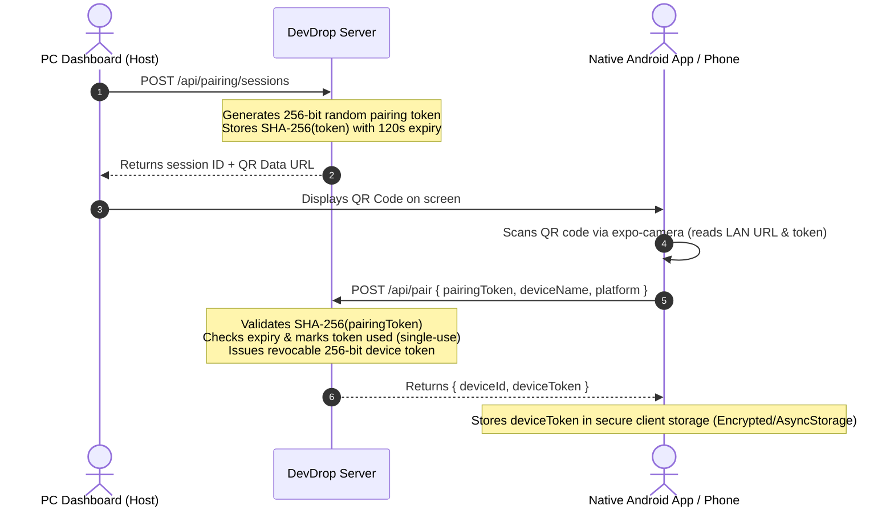

# DevDrop — Security Architecture & Threat Model

**Version:** 2.0  
**Scope:** Local-network file sharing system (PC host, Chrome extension, & Android clients)

---

## 1. Security Philosophy

DevDrop is designed around the principle of **local-first privacy and controlled authorization**:
- **No Cloud Uploads:** No data leaves your local Wi-Fi or LAN network.
- **Zero Third-Party Accounts:** No central registry, identity providers, or cloud accounts.
- **Untrusted Network Assumption:** A local Wi-Fi network is **not automatically a trusted network**. Malicious devices or unauthorized observers on the same network must not be able to forge transfers, execute arbitrary code, or access host files.

---

## 2. Authentication & Pairing Lifecycle



### 2.1 Temporary Pairing Tokens
1. **Entropy:** 32 cryptographically secure random bytes (`crypto.randomBytes(32)`), represented as 64 hex characters.
2. **Short-Lived:** Tokens expire strictly after 120 seconds (`PAIRING_EXPIRY_SECONDS=120`).
3. **Single-Use:** Once exchanged via `/api/pair`, the token is immediately marked `used_at = now`. Any subsequent attempt is rejected with `409 TOKEN_USED`.
4. **Hashed at Rest:** Only `SHA-256(pairingToken)` is stored in the database. The plain pairing token is never persisted.
5. **No Permanent Secrets in QR Codes:** QR codes contain only the temporary token and server LAN URL. Permanent device credentials are never embedded in QR codes.

### 2.2 Device Bearer Credentials
- Following successful pairing, a unique 256-bit random device token is generated.
- Only the `SHA-256` hash is stored in the `devices` table.
- Every API and Socket.IO interaction from mobile requires `Authorization: Bearer <deviceToken>`.
- **Immediate Revocation:** The PC host user can revoke any device at any time from the dashboard. Revoked tokens are rejected with `403 DEVICE_REVOKED`.

---

## 3. File Safety & Storage Security

### 3.1 Path Traversal Prevention
> [!IMPORTANT]
> Uploaded filenames provided by clients are **never used directly as filesystem paths**.

- Filenames are sanitized via `sanitizeFilename`:
  - Strips path separators (`/`, `\`), null bytes (`\0`), and directory traversal sequences (`..`).
  - Limits length to 255 characters.
  - Generates safe fallback names if empty.
- Paths are resolved using `resolveSafePath` which verifies that the canonical destination is strictly a sub-path of the designated storage directory:
  ```ts
  if (!resolved.startsWith(normalizedBase + path.sep)) {
    throw new Error('Path traversal detected');
  }
  ```

### 3.2 Filename Collision Handling
- When a file with the same name already exists in `From-Mobile` or `From-PC`, DevDrop appends an incrementing counter rather than overwriting existing data (`report (1).pdf`).

### 3.3 Atomic Finalization & Incomplete File Protection
- Incoming uploads stream into `Files/Temporary/<transferId>.tmp`.
- In-flight or failed transfers are never exposed as completed files.
- Upon completion and byte count verification, the file is atomically renamed (`fs.renameSync`) into its target folder (`From-Mobile` or `From-PC`).
- If an upload is aborted or errors, the temporary `.tmp` file is immediately unlinked.

### 3.4 Non-Execution & Safe Storage
- Files received by the server are stored as passive data. DevDrop never executes, runs, or automatically opens received files.

### 3.5 Quick Text & Clipboard Sharing Security
- Text transfers (`POST /api/text`) validate string input and enforce a strict payload size limit (max 500 KB) to prevent memory exhaustion attacks.
- Text content is stored securely under `Files/From-<Source>/Text/` as passive `.txt` files with UUID identifiers to prevent overwriting or script injection.

---

## 4. Native Messaging Security

The Chrome extension communicates with the PC host using Chrome's native messaging API:
- **Registry Key Isolation:** The native messaging manifest is registered strictly in the current user's registry hive (`HKCU\Software\Google\Chrome\NativeMessagingHosts\com.devdrop.launcher`).
- **Origin Locking:** The native messaging manifest specifies `"allowed_origins": ["chrome-extension://<EXTENSION_ID>/"]`, ensuring that only the authorized DevDrop extension can invoke the native host.
- **Strict Command Whitelist:** The host script (`tools/native-host.cjs`) exclusively accepts predefined JSON commands (`status`, `start`, `stop`). Arbitrary shell execution is completely disallowed.

---

## 5. Network Security & Firewall Guidelines

### 5.1 Private Network Binding
- DevDrop is strictly designed for private LAN subnets (e.g. `192.168.x.x`, `10.x.x.x`).
- **Never expose DevDrop through router port forwarding or public DMZ.**

### 5.2 Windows Firewall Configuration
- Restrict Windows Firewall inbound rules on port `4545` to **Private** networks only. Do not enable on Public Wi-Fi networks (e.g. airport or public cafe networks).
